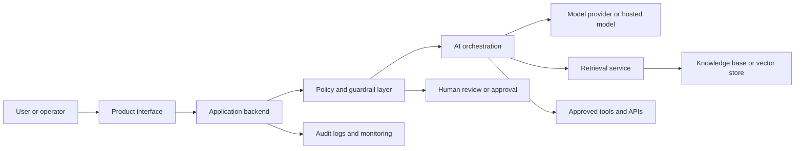
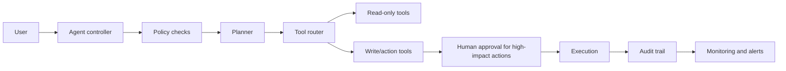
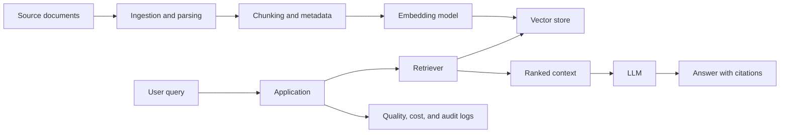

# Mermaid Diagram Guidelines for AI Architecture Reviews

Use diagrams to make the architecture review faster to understand and easier to discuss with stakeholders.

## Default style

Use Mermaid `flowchart LR` unless the user asks for sequence, deployment, or process views.

Prefer readable component names over implementation jargon. Keep diagrams at one meaningful abstraction level.

## Common component groups

Use these groups when helpful:

- User and channels: web app, mobile app, chat, admin UI, API client.
- Application layer: backend, orchestration service, workflow engine, agent controller.
- AI layer: prompt layer, model router, LLM, embedding model, classifier, reranker.
- Knowledge layer: document store, vector DB, search index, knowledge base, metadata store.
- Tool layer: CRM, ERP, email, calendar, ticketing, database, browser, internal APIs.
- Control layer: policy engine, guardrails, approval workflow, audit logging, monitoring.
- Data layer: source systems, sensitive data store, analytics, logs, telemetry.

## High-level system diagram pattern

## Agentic workflow pattern

Use this when an AI system can call tools or take actions.

## RAG pattern

Use this when the system uses retrieval-augmented generation.

## Diagram review checklist

Before finalizing a diagram, check:

- Are sensitive data flows visible?
- Are external vendors and APIs visible?
- Are human approval points visible?
- Are logs, monitoring, and audit trails visible?
- Are permission boundaries and tool boundaries visible?
- Is the diagram understandable without a long explanation?
