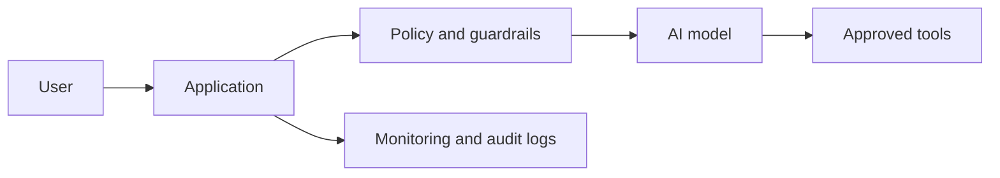

# Consulting-Ready AI Architecture Review Template

Use this template for substantial reviews. Adapt length to the user's request.

## Title

# AI Architecture Review: [system or project name]

## 1. Executive summary

Write 3-6 bullets:

- Overall decision stance: go, conditional go, no-go, or needs discovery.
- Main value proposition.
- Top 2-3 risks.
- Highest-impact recommendations.
- Confidence level and why.

## 2. Architecture understanding

Explain in plain language:

- What the system is intended to do.
- Primary users and stakeholders.
- Main data sources.
- AI/model components.
- External systems, tools, or APIs.
- Human review or approval points.

Distinguish confirmed facts from assumptions.

## 3. System diagram

Provide Mermaid by default:

After the diagram, add 3-5 bullets explaining the most important flows and missing components.

## 4. Key findings

Group findings by theme. For each finding, include implication and recommended direction.

Example:

### Finding 1: Retrieval is central but not yet governed

- Evidence: [what indicates this]
- Why it matters: [business/technical consequence]
- Direction: [what should change]

## 5. Risk matrix

Use this table:

| ID | Risk | Category | Severity | Likelihood | Priority | Evidence | Business impact | Recommendation |
|---|---|---|---|---|---|---|---|---|
| R1 | ... | ... | high | medium | p1 | ... | ... | ... |

Keep risk statements specific. Avoid generic rows like "security risk" without a concrete failure mode.

## 6. Recommendations

Prioritize 5-10 recommendations. Use this format:

| Priority | Recommendation | Owner | Effort | Impact | Timing |
|---|---|---|---|---|---|
| 1 | ... | product/engineering/security/data | medium | high | before launch |

Then add a short narrative for the top 3 recommendations.

## 7. Implementation roadmap

Use when the user asks for execution planning or when risks are substantial.

- Now: controls needed before further build or launch.
- Next sprint: improvements that reduce major risk.
- Before launch: validation, monitoring, governance, security, and operational readiness.
- Post-launch: optimization, scale, and continuous improvement.

## 8. Open questions

List the minimum questions needed to improve confidence, grouped by:

- Product and user journey.
- Data and privacy.
- Model and evaluation.
- Security and tool permissions.
- Operations and governance.

## 9. Assumptions and limitations

State what was not reviewed. Examples:

- No source code was inspected.
- No production telemetry was provided.
- No legal review was performed.
- Architecture diagram was inferred from notes.

## 10. Decision stance

End with one clear paragraph:

- Go: proceed with named monitoring and ownership.
- Conditional go: proceed only after specific controls are implemented.
- No-go: do not launch or scale until critical gaps are fixed.
- Needs discovery: gather named evidence before deciding.
